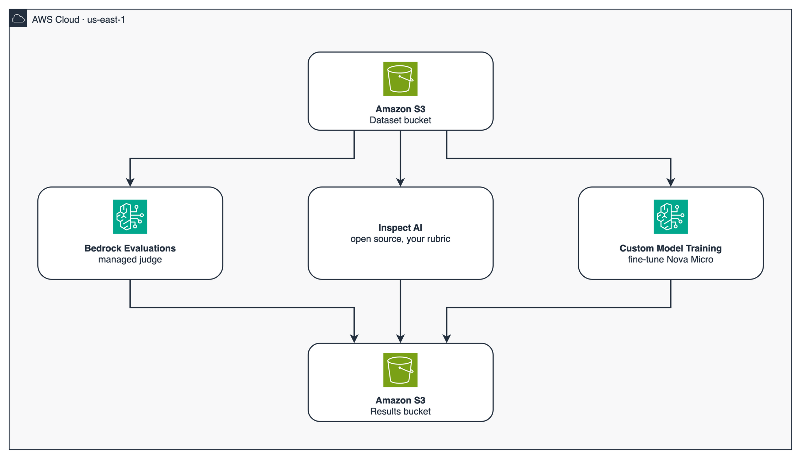

# Benchmark-to-Build: Sovereign AI Evaluation and Fine-Tuning

Benchmark foundation models on Amazon Bedrock against jurisdiction-specific data, try ways to close the gaps (fine-tuning, retrieval-augmented generation and agentic search), and re-benchmark to see which one actually helped.

This sample works with Amazon Bedrock (model evaluation, Knowledge Bases and custom model fine-tuning), Amazon S3 Vectors and Amazon SageMaker Unified Studio.

> **Disclaimer:** This is a proof-of-concept demonstrating the *methodology* for building jurisdiction-specific AI evaluations. The author is not a legal, medical, or education subject matter expert. Domain experts must own the creation, validation, and maintenance of production-grade evaluation datasets. This is not legal, medical, or educational advice.

## Why This Exists

Every major AI benchmark (HELM, MMLU, MedQA, LegalBench) is calibrated for US/international contexts. Government customers and regulated enterprises in other jurisdictions are making procurement decisions based on scoreboards that measure fitness for someone else's legal system, clinical guidelines, or educational curriculum.

This project demonstrates:

1. **How to build** a jurisdiction-specific evaluation dataset from authoritative national sources
2. **How to score** foundation models against it using two complementary LLM-as-judge paths (Bedrock Evaluations + Inspect AI)
3. **How to close the gaps** the benchmark finds, and measure whether each attempt worked: fine-tuning (Bedrock Custom Model Training), retrieval-augmented generation (Bedrock Knowledge Bases) and agentic search (Strands Agents)

The benchmark decides which approach fits. In the sample run, fine-tuning Nova Micro on 200 examples made no measurable difference (0.20 untuned, 0.22 fine-tuned), because the gap is missing knowledge of the law, which retrieval addresses and fine-tuning doesn't. See Module 4 for why.

The methodology is domain-agnostic and jurisdiction-agnostic. Australian legal is the proof-of-concept domain.

## Architecture

![Benchmark-to-Build architecture: a user signs in through AWS IAM Identity Center to SageMaker Unified Studio in a private subnet of a VPC. Studio reaches the datasets, results and project buckets in Amazon S3 through an S3 gateway endpoint, and reaches Amazon Bedrock through a NAT gateway: foundation models (candidates and the LLM-as-a-judge model), Bedrock Evaluations, the Cohere Rerank model, and a Knowledge Base using Titan Text Embeddings V2 that stores and queries the legislation index in Amazon S3 Vectors. Optional Module 3, in us-east-1 only, uses AWS CloudShell to run Bedrock Custom Model Training on Nova Micro with its own fine-tuning bucket.](docs/diagrams/benchmark-to-build-full-architecture.png)

The notebooks run in SageMaker Unified Studio. They read the datasets and write scores
to Amazon S3, call Amazon Bedrock models through Inspect AI and Bedrock Evaluations,
and query a Bedrock Knowledge Base backed by Amazon S3 Vectors for retrieval. Module 3's
optional fine-tuning runs separately from AWS CloudShell.

The diagram shows the full environment that `infrastructure/cloudformation/benchmark-to-build.yaml`
creates. The CDK stacks create the S3 buckets, IAM roles and policies, and the Bedrock
Knowledge Base on S3 Vectors; with CDK you bring your own notebook environment. The
editable source is
`docs/diagrams/benchmark-to-build-full-architecture.drawio`.

<details>
<summary>Earlier diagram: benchmarking and fine-tuning flow</summary>

The original diagram, which shows the benchmarking and fine-tuning flow only (it
predates the retrieval modules). Source: `docs/diagrams/benchmark-to-build-architecture.drawio`.



</details>

## Modules

Notebooks live in `notebooks/`. Run them in order after deploying the infrastructure.

| Module | Notebook | What it does |
|--------|----------|-------------|
| Module 1 | `Module-1-Build-Dataset.ipynb` | Build and upload evaluation + training datasets to S3 |
| Module 2 | `Module-2-Evaluation.ipynb` | Benchmark 14 models via Inspect AI (open-source LLM-as-judge with a legal rubric), plus a representative 3 via Bedrock Evaluations (managed LLM-as-judge) |
| Module 3 | `Module-3-Fine-Tune.md` *(no notebook)* | Optional: run a Bedrock fine-tuning job on Nova Micro from AWS CloudShell. Steps: **[docs/MODULE-3-FINE-TUNE.md](docs/MODULE-3-FINE-TUNE.md)** |
| Module 4 | `Module-4-Fine-Tune-Results.ipynb` | Load the pre-run fine-tuning results (`datasets/legal/processed/finetune-prerun-results.json`) and compare with untuned Nova Micro, overall, question by question (McNemar) and by category. Also shows your own Module 2 Nova Micro score, if you've run Module 2 |
| Module 5 | `Module-5-RAG.ipynb` | Grounding: RAG, then RAG + reranking, scored on the same 50 items |
| Module 6 | `Module-6-Agentic-Search.ipynb` | Agentic search with Strands: four retrieval tools (exact section lookup, literal keyword search, semantic search, cross-reference navigation), scored and compared to Module 5 with a paired item-level test |

The notebooks never train or deploy a model. Fine-tuning was run ahead of time and
its scores ship with the datasets; Module 3 shows how to run it yourself. If you deploy a fine-tuned model yourself, it bills until it's
deleted. See **[docs/CLEANUP.md](docs/CLEANUP.md)**.

## CDK Stacks

| Stack | Purpose |
|-------|---------|
| `AuBenchmark-legal-Data` | S3 buckets for datasets and results |
| `AuBenchmark-legal-Evaluation` | IAM roles for Bedrock model evaluation |
| `AuBenchmark-legal-FineTuning` | IAM roles for Bedrock custom model training |
| `AuBenchmark-legal-KnowledgeBase` | Bedrock Knowledge Base on S3 Vectors for Modules 5 and 6 |

Stack names follow the pattern `AuBenchmark-{domain}-{StackType}`.

## Prerequisites

- AWS account with access to Amazon Bedrock in **us-east-1** or **us-west-2** (the optional Module 3 fine-tuning runs in us-east-1 only)
- Bedrock model access enabled for: Amazon Nova family, Anthropic Claude, Meta Llama, Mistral, OpenAI, NVIDIA Nemotron
- SageMaker Studio or JupyterLab environment whose execution role has these managed policies attached:
  - `NotebookPolicyArn` (Evaluation stack output) for Modules 1, 2 and 4
  - `NotebookRagPolicyArn` (KnowledgeBase stack output) for Modules 5 and 6
- Node.js 20 or later and the AWS CDK v2 CLI (installed by `npm install`) to deploy the stacks
- Python 3.10 or later for the notebooks; packages: see `notebooks/requirements-notebooks.txt`

### Running the notebooks

Every notebook opens with a **Step 0** cell that runs `%pip install -q -r requirements-notebooks.txt`. Run it first, **every session**, and **restart the kernel afterwards**. The kernel is not persistent — restarting a SageMaker Unified Studio space wipes installed packages, and the failure then surfaces much later as a confusing `ModuleNotFoundError`.

### Expected harmless errors in SageMaker Unified Studio

Unified Studio's own file and catalog browsers probe for features this project does not use. They fail, and the failures appear in CloudTrail and sometimes in the UI. **None of these come from the notebooks and none of them need fixing:**

| Action | Error | Source |
|---|---|---|
| `s3:GetAccessGrantsInstanceForPrefix` | `AccessDenied` | Studio's S3 browser looking for an S3 Access Grants instance |
| `s3:GetDataAccess` | `AccessGrantsInstanceNotExistsError` | same — fires on notebook S3 reads and writes |
| `s3tables:ListTableBuckets` | `AccessDenied` | Studio's catalog panel enumerating S3 Tables |
| `ram:ListResources` | `AccessDenied` | same catalog sweep, shared-resource discovery |

They recur throughout a normal, fully working session — a clean run of Module 5 (RAG) produced 22 of them. If you are auditing CloudTrail for genuine permission problems, filter these out first; anything *else* denied on `bedrock:*`, `cloudformation:DescribeStacks` or the project buckets is real and worth chasing.

## Quick Start

```bash
# The CDK app lives in infrastructure/cdk
cd infrastructure/cdk

# Install CDK dependencies
npm install

# Build and synthesise
npm run build
npx cdk synth

# Deploy all stacks to the region your AWS CLI is set to (us-east-1 or us-west-2)
npx cdk deploy --all

# Back to the repository root for the dataset upload
cd ../..

# Get stack outputs (bucket names, role ARNs)
aws cloudformation describe-stacks \
  --stack-name AuBenchmark-legal-Data \
  --query 'Stacks[0].Outputs'

# Upload the datasets the notebooks read
BUCKET=<DatasetBucketName>
aws s3 cp datasets/legal/processed/eval-legal-au.jsonl s3://$BUCKET/legal/        # Modules 1, 2, 5, 6
aws s3 cp datasets/legal/processed/train-legal-au.jsonl s3://$BUCKET/legal/       # Module 1
aws s3 cp datasets/legal/processed/finetune-prerun-results.json s3://$BUCKET/legal/   # Module 4
aws s3 sync datasets/legal/corpus/text/ s3://$BUCKET/legal/corpus/ \
  --exclude "*" --include "*.txt"                                                  # Modules 5, 6
```

The notebooks find bucket names, role ARNs and the Knowledge Base ID by reading the
CloudFormation outputs in the region (`DatasetBucketName`, `ResultsBucketName`,
`EvaluationRoleArn`, `KnowledgeBaseId`, `DataSourceId`), so there is nothing to edit
by hand. Deploy **either** the CDK stacks **or** `infrastructure/cloudformation/benchmark-to-build.yaml`
in a region, not both: their outputs share these names.

### Alternative: one CloudFormation template

`infrastructure/cloudformation/benchmark-to-build.yaml` builds everything in one stack, including a
SageMaker Unified Studio domain and project to run the notebooks in. Leave
`AssetsBucketName` and `AssetsBucketPrefix` blank, then upload the datasets with the
commands above and open the notebooks from this repository. (Alternatively, upload a
zip of this repository named `benchmark-to-build.zip` to a bucket and pass that
bucket and prefix: the stack then copies the datasets for you.)

The stack creates an IAM Identity Center user, `analyst`, to sign in to SageMaker
Unified Studio with. The identity store API can't set a password, so after the stack
completes, open the IAM Identity Center console, choose **Users → analyst → Reset
password**, generate a one-time password, and sign in at the `DomainPortalUrl` stack
output.

## Dataset Format

### Evaluation (Bedrock Evaluations / Inspect AI):

```jsonl
{"prompt": "Your question here", "referenceResponse": "Expected answer sourced from legislation", "category": "topic"}
```

### Fine-tuning (Bedrock Custom Model Training):

```jsonl
{"system": "You are an expert in AU legal law.", "messages": [{"role": "user", "content": "Question"}, {"role": "assistant", "content": "Answer"}]}
```

## Tested Models

Module 2 evaluates 14 models across 6 providers via Inspect AI (`CANDIDATE_MODELS`), and a
representative 3 via Bedrock Evaluations (`MANAGED_MODELS`: Claude Sonnet 4.5, Nova Pro,
Nova Micro — that path grades the full dataset server-side, so it is kept short deliberately):

| Provider | Models |
|----------|--------|
| Amazon Nova | Pro, Lite, Micro |
| Anthropic | Claude Sonnet 4.5, Claude Haiku 4.5 |
| Meta | Llama 4 Maverick 17B, Llama 3.3 70B |
| Mistral | Mistral Large 3, Ministral 14B |
| OpenAI | GPT-OSS 120B, GPT-OSS 20B |
| NVIDIA | Nemotron Super 120B, Nemotron Nano 30B, Nemotron Nano 12B |

Module 3 fine-tunes: **Amazon Nova Micro** (Bedrock Custom Model Training, SFT).

## Extending to Other Domains

1. Add a domain config in `infrastructure/cdk/lib/config/domains.ts` and register it
   in the `DOMAINS` map in `infrastructure/cdk/bin/benchmark-to-build.ts`
2. Create evaluation and training datasets, and upload them under `<domain>/` in the
   dataset bucket
3. Deploy from `infrastructure/cdk`: `npx cdk deploy --all -c domain=<id>` (an unregistered id stops with an error)
4. Set `DOMAIN` and `JURISDICTION` in each notebook's configuration cell

## Data Sources (Legal Domain, Australian PoC)

| Source | URL | Licence |
|--------|-----|---------|
| Federal Register of Legislation (9 Commonwealth Acts) | legislation.gov.au | CC BY 4.0 |
| NSW legislation (3 NSW Acts) | legislation.nsw.gov.au | CC BY 4.0 |

The RAG corpus is the 12 Acts only, a processed copy rather than the authorised
version. Some questions and training answers cite leading Australian cases by name
(for example *Cole v Whitfield*); no case-law text is included. Provenance, pinned versions and attribution are in
`datasets/legal/corpus/SOURCES.md`.

## Project Structure

```
├── notebooks/                 # Modules 1-6 (Module 3 is a pointer to docs/) and requirements-notebooks.txt
│   └── tests/                 # Notebook tests (Python, stdlib only)
├── datasets/
│   └── legal/
│       ├── corpus/            # Pinned source legislation for RAG (see SOURCES.md)
│       ├── processed/         # Evaluation-ready JSONL (eval + train) and pre-run fine-tuning results
│       └── scripts/           # Corpus collector and its tests
├── infrastructure/
│   ├── cdk/                   # CDK app (TypeScript)
│   │   ├── bin/               # App entry point
│   │   ├── lib/config/        # Domain configurations
│   │   ├── lib/stacks/        # Data, evaluation, fine-tuning and knowledge base stacks
│   │   └── test/              # CDK tests (jest)
│   └── cloudformation/        # One-stack environment template and the Module 3 fine-tuning template
└── docs/                      # Module 3 steps, cleanup and architecture diagrams
```

### Running the tests

```bash
(cd infrastructure/cdk && npm test)                                   # CDK stacks
python3 -m unittest discover -s notebooks/tests -p 'test_*.py'        # notebooks
python3 -m unittest discover -s datasets/legal/scripts -p 'test_*.py' # corpus collector
```

## Security

See [CONTRIBUTING](CONTRIBUTING.md#security-issue-notifications) for more information.

This sample creates IAM roles and policies in your account. Some Amazon Bedrock
actions it uses, such as creating evaluation jobs and invoking models, don't
support resource-level permissions, so those statements apply to all resources.
Review the policies before deploying, and deploy into a non-production account.

## Data licensing

The legislation in `datasets/legal/corpus/text/` is licensed under CC BY 4.0 by its
publishers; see [NOTICE](NOTICE) and `datasets/legal/corpus/SOURCES.md` for the
required attribution. The rest of this repository, including the evaluation and
training datasets, is licensed under MIT-0.

## Support

This sample is provided as is and is not an officially supported AWS product.

## License

This library is licensed under the MIT-0 License. See the [LICENSE](LICENSE) file.
